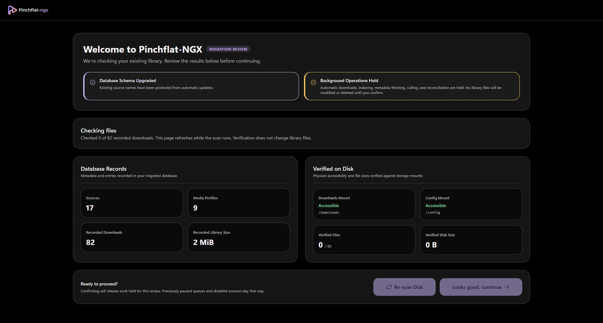
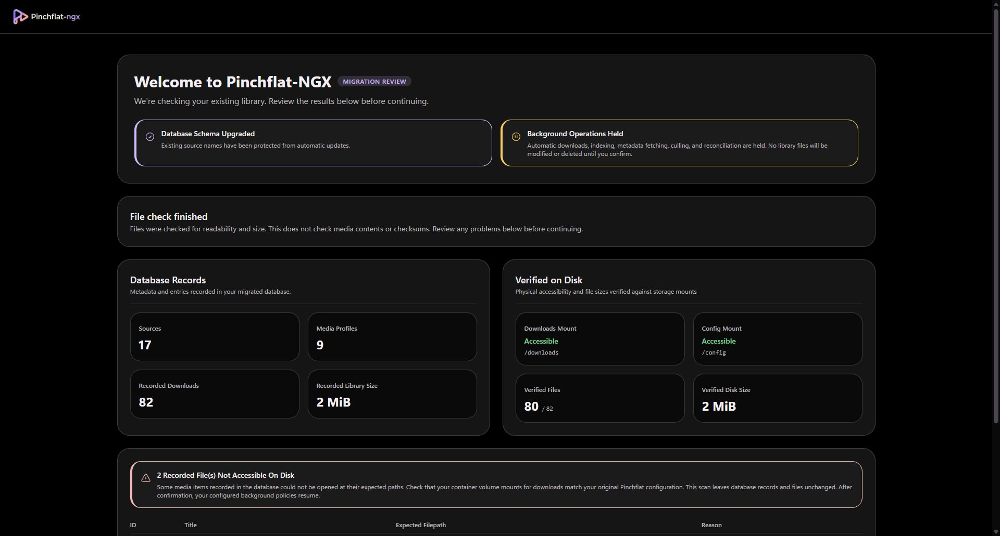
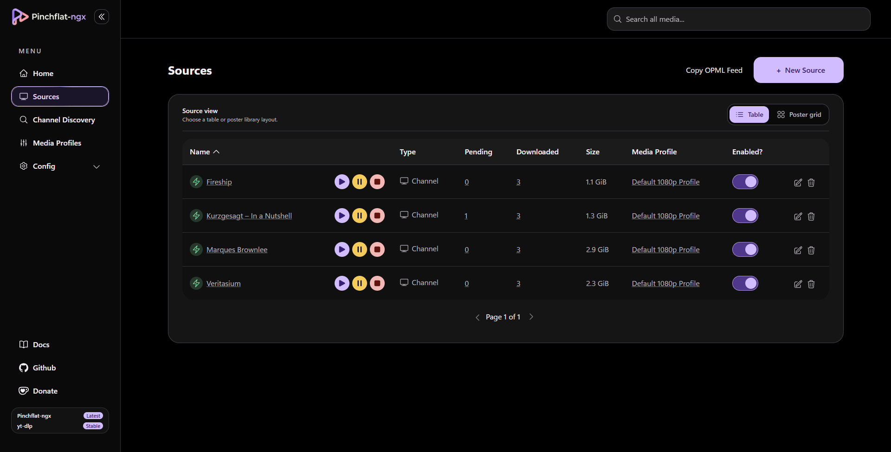
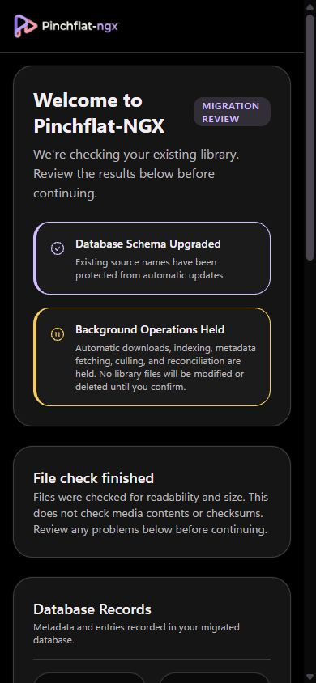

# Migrating from Pinchflat

You can move from upstream **Pinchflat** to **Pinchflat-NGX** without re-creating your sources. Keep the same data on disk; change how you run the container.

Pinchflat-NGX upgrades the database and settings in your **config** folder on first start. It does **not** move or rewrite your files under **downloads**.

> **Optional:** If you want a safety copy of config before you switch images, see [Backing up config before migration](backing-up-config-before-migration.md). You do not need that page to migrate.

## What you keep (do not throw away)

These are the same as today:

| Item                             | Host (typical)   | Inside the container |
| -------------------------------- | ---------------- | -------------------- |
| Library database, settings, logs | `./config`       | `/config`            |
| Downloaded media                 | `./downloads`    | `/downloads`         |
| Port mapping                     | e.g. `8945:8945` | unchanged            |
| Timezone env                     | e.g. `TZ: …`     | unchanged            |

Your sources, media profiles, and download history live in `./config` (SQLite at `config/db/pinchflat.db` by default).

## What you change

In `compose.yaml`, swap the **image** to the Pinchflat-NGX SQLite image. Keep the service name and mounts the same; renaming the service is unnecessary.

**Before (upstream Pinchflat example):**

```yaml
services:
  pinchflat:
    image: ghcr.io/kieraneglin/pinchflat:latest
    environment:
      TZ: America/Regina
    volumes:
      - ./config:/config
      - ./downloads:/downloads
    ports:
      - '8945:8945'
```

**After (Pinchflat-NGX):**

```yaml
services:
  pinchflat:
    image: ghcr.io/thebadfella/pinchflat-ngx:latest
    environment:
      TZ: America/Regina
    volumes:
      - ./config:/config
      - ./downloads:/downloads
    ports:
      - '8945:8945'
    restart: unless-stopped
```

The image changes; both volume mounts and the port mapping stay the same. Keep any existing settings not shown in this example.

## What you add

For a straight SQLite migration, you usually **do not** add new environment variables. Keep using the `latest` image (not `latest-postgres`) until you deliberately migrate to PostgreSQL elsewhere.

If you use Basic Auth, OIDC, or other env vars today, copy them unchanged into the NGX service block.

## What you should not change

- **Do not** point `./config` or `./downloads` at empty folders.
- **Do not** delete `pinchflat.db` or re-create sources unless you intend to start fresh.
- **Do not** change container paths `/config` and `/downloads` unless you know every path stored in the database still resolves.

Optional: rename the host folder (e.g. `./pinchflat-config` → `./pinchflat-ngx-config`) only if you update the Compose bind path to match. Container paths stay `/config` and `/downloads`.

## Switch in three steps

1. **Stop** upstream Pinchflat: `docker compose stop`
2. **Edit** `compose.yaml` as above, keeping the same config and downloads mounts.
3. **Start** NGX: `docker compose pull && docker compose up -d`, then open `http://<host>:8945`.

## First start: migration welcome screen

> **Upcoming update:** The review screen shown below is part of the migration update tracked in [PR #86](https://github.com/TheBadFella/Pinchflat-NGX/pull/86). The current image may open the dashboard directly.

When a legacy Pinchflat installation is detected, NGX shows a **migration welcome** screen and holds background operations while you review the library. New installations and installations already migrated to NGX do not need this review again.



Wait for the file check to finish. **Database Records** shows what your library database contains; **Verified on Disk** shows accessible files and their sizes. This checks readability and size, not media contents or checksums.



These are example captures from a test library. If files are inaccessible, check the host storage and Compose mounts, correct them, then choose **Re-scan Disk**. The review does not delete missing records or change library files.

When the results look right, choose **Looks good, continue** at the bottom of the review. This releases work held for migration; previously paused queues and disabled sources stay that way. Your configured download and retention policies can then resume. Missing channel artwork can be fetched without redownloading your media.



<details>
<summary>Welcome screen on mobile</summary>



</details>

> Schema upgrades run when the container starts, before this screen. The screen is a library review, not approval before database changes.

## Check that it worked

- Sources list looks complete.
- Open a source you know has downloads; paths still work.
- No unexpected mass re-download (if the welcome screen reported mount problems, fix mounts first).
